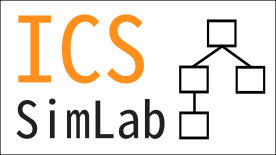

# Curtin ICS-SimLab: a Containerized Approach for Simulating Industrial Control Systems for Cyber Security Research




> This work is supported by a Cross-Campus Cyber Security Research Project
funded by **Curtin University**.

**"Curtin ICS-SimLab" is a software suite designed to simulate general Industrial Control Systems through a configurable, containerized environment.**

---


## DNP3 Extension

**The DNP3 protocol support and the solar plant scenarios in this repository were developed by Van Sanh Vu** (MPhil, School of EECMS, Curtin University) as part of research on intrusion detection for energy-sector ICS. The base ICS-SimLab framework (Modbus TCP/RTU, HIL, sensors, actuators, PLCs, HMIs and the dashboard) is the work of Jaxson Brown et al. — see [Citation](#citiation) below.

Contributions by Van Sanh Vu:

- **DNP3-TCP components** (port 20000, built on [`dnp3-python`](https://pypi.org/project/dnp3-python/)):
  - `dnp3_master` — SCADA master: Class 0123 integrity polls, unsolicited responses, DirectOperate commands, REST API (`GET /registers`, `POST /command/<outstation>`)
  - `dnp3_outstation` — solar inverter outstation mapping HIL physical values to DNP3 analogue/binary inputs and outputs
- **Solar plant scenarios**:
  - `config/solar_plant` — SCADA master + 2 inverter outstations
  - `config/solar_plant_500kw` — 500 kW plant with 5 × 100 kW grid-tied inverters and point-of-common-coupling (grid voltage/frequency) measurements
- **Physically correlated HIL logic** for the solar scenarios (irradiance, temperature derating, grid-locked voltage/frequency, fault and online status)
- **Dashboard support** for DNP3 components, setup/Docker integration, and unit and integration tests (`curtin-ics-simlab/tests/`)

Run a DNP3 scenario from `curtin-ics-simlab/`:

```bash
sudo ./start.sh config/solar_plant        # or config/solar_plant_500kw
```

---


## Citiation

This repository contains the implementation of the following paper:

> J. Brown, D. S. Pham, S. Soh, F. Motalebi, S. Eswaran, M. Almsahor, "ICS-SimLab: a Containerized Approach for Simulating Industrial Control Systems for Cyber Security Research" in Proceedings of the First International Workshop on Secure Industrial Control Systems and Industrial IoT, France, 2025. (Forthcoming)

**Abstract:**

Industrial Control Systems (ICSs) manage processes in environments such as chemical plants and water treatment facilities. As these systems increasingly connect to the Internet, they face higher risks of cyberattacks, making ICS-specific Intrusion Detection Systems (IDS) essential. Since testing on live systems is impractical and unsafe, researchers rely on simulated testbeds. Existing testbeds are often limited, lacking flexibility to model diverse ICS architectures.

This repository presents **ICS-SimLab**, a Docker-based framework for building configurable ICS simulations aligned with the Purdue Enterprise Reference Architecture. ICS-SimLab supports multiple environments. This repository has 3 predefined simulations built with ICS-SimLab: a solar panel smart grid, a water bottle filling facility, and a network of intelligent electronic devices. 

```yaml
If you find this work useful, then please consider for citing the paper:

@inproceedings{brown2025ics-simlab,
  title        = {ICS-SimLab: a Containerized Approach for Simulating Industrial Control Systems for Cyber Security Research},
  author       = {Brown, Jaxson and Pham, Duc-Son and Soh, Sieteng and Motalebi, Foad and Eswaran, Sivaraman and Almashor, Mahathir},
  year         = {2025},
  note         = {Accepted for publication},
  booktitle    = {First International Workshop on Secure Industrial Control Systems and Industrial IoT},
  institution  = {Curtin University},
  organization = {IEEE},
}
```

## Quickstart
Run `sudo ./start.sh <configuration>` to start the simulation, where `<configuration>` is a directory for a configured simulation.

Pre-configured simulations are found in */config/\**.

E.g. to run the water bottle filling facility simulation, run `sudo ./start.sh config/water_bottle_factory`.


## Documentation
1. Refer to [init.md](docs/init.md) to start a preconfigured simulation.
2. Refer to [architecture.md](docs/architecture.md) to understand the architecture of the simulation.
3. Refer to [configure.md](docs/configure.md) to learn to configure a custom SCADA simulation.

It is recommended to read the documentation in this order.
